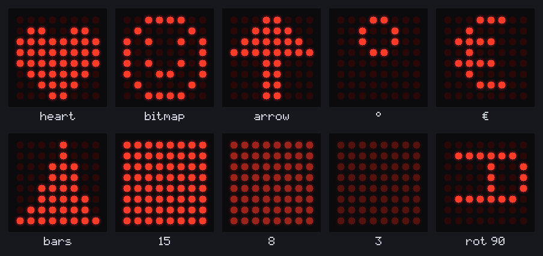
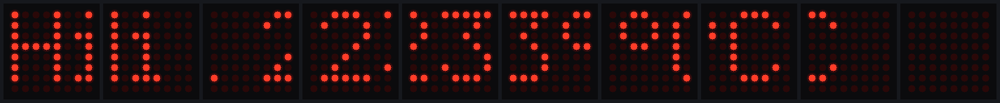
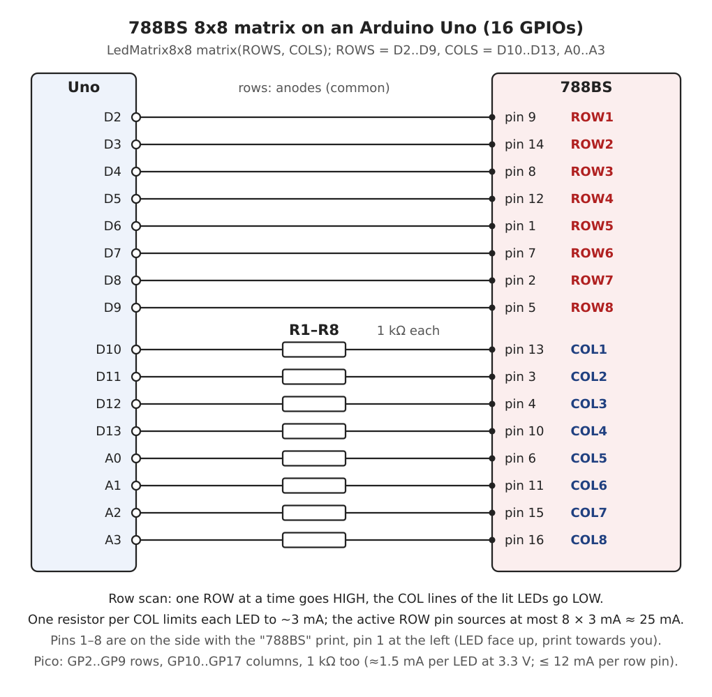

# led-matrix-8x8

A driver for **bare 8x8 LED dot matrices**: the 16-pin modules without a controller chip, such as
the **788BS** / **788AS** (20 mm, 1.9 mm dots), the **1088BS** / **1088AS** (32 mm, 3 mm dots) and the
1588 series. They can be driven straight from **16 GPIOs** or from **two 74HC595** shift registers.





*The driver renders these pictures itself. They go through the real multiplexing into the fake
matrix in `tests/`, and each LED is painted with the share of time it was really lit, so the
brightness steps 15 / 8 / 3 are measured, not drawn (`make docs`). The values are made up.*

- **Multiplexing that doesn't ghost.** One scan line at a time, with all lines switched off
  between two scan lines. Pins that change one by one never light the wrong LEDs. Rows or
  columns can be scanned.
- **Brightness 0..15** by on-time per line. The timing comes from a microsecond clock you pass
  in, so it is not tied to one timer or core. `ledm_step()` covers fixed-rate timer interrupts.
- **Common anode ("BS") and common cathode ("AS")**, plus inverting drivers (PNP high side,
  ULN2803 low side) through two polarity flags. Supports rotation by 90° steps and mirroring.
- **Drawing:** pixels, rows, columns, bitmaps (also from PROGMEM), shifting with wrap or fill,
  single bars and bar graphs.
- **Text in UTF-8** with its own proportional 5x7 font: ASCII plus ° ± ² ³ µ · Ä Ö Ü ß ä ö ü
  € ← ↑ → ↓ █. Includes a centred single character and a scroller that can loop.
- **Portable C99 core** with no Arduino headers, no `malloc` and no `float`. One callback sets the
  16 lines.
- **Precompiled** for ESP8266, ESP32, RP2040, ATmega328P and ATmega2560. Only the thin Arduino
  adapter is compiled with your core.

## Supported platforms

| Target (`.a` folder) | Boards | Built with | Checked against (real firmware in CI) |
|---|---|---|---|
| `esp8266` | Wemos/LOLIN D1 mini, NodeMCU | xtensa-lx106-elf GCC 10.3 | Arduino ESP8266 core 3.1.2 (`d1_mini`) |
| `esp32` | ESP32 DevKit, WROOM/WROVER | xtensa-esp32-elf GCC 8.4 | Arduino ESP32 core 3.3.13 (`esp32`); built with the 2.0.17 compiler, so it links with 2.0.x too |
| `cortex-m0plus` | Raspberry Pi Pico, Pico W (RP2040) | Arm GNU Toolchain 13.2 | arduino-pico 6.4.0 (`rpipicow`); also usable with pico-sdk |
| `atmega328p` | Uno, Nano, Pro Mini | avr-gcc 7.3 | Arduino AVR core 1.8.6 (`uno`) |
| `atmega2560` | Mega 2560 | avr-gcc 7.3 | Arduino AVR core 1.8.6 (`mega`) |
| `linux-x86_64` | PC tools, tests | GCC | host tests with ASan/UBSan |

The core uses 2.9 KB of flash on the RP2040 and 4.6 KB on AVR with everything in, including the
font. Unused functions are dropped by the linker. In RAM it needs 41 bytes per matrix, plus
17 bytes for a scroller. The *HelloMatrix* example needs 5.7 KB of flash and 149 bytes of RAM on
an Uno.

## The module's pins

Pins 1..8 are on the side with the printed part number. Pin 1 is at the left end when you look
at the LED face with that side towards you. Pins 9..16 run back along the other side, with 16
opposite 1. Which corner ends up as pixel (0, 0) depends on how the module sits on your board:
turn the picture with `setRotation()` / `setMirror()` instead of rewiring.

| | 1 | 2 | 3 | 4 | 5 | 6 | 7 | 8 |
|---|---|---|---|---|---|---|---|---|
| **ROW** = module pin | 9 | 14 | 8 | 12 | 1 | 7 | 2 | 5 |
| **COL** = module pin | 13 | 3 | 4 | 10 | 6 | 11 | 15 | 16 |

All of the 788/1088/1588 modules have the same layout. Only the polarity differs: **BS** = common
anode (ROW = anode, an LED lights with ROW high and COL low) and **AS** = common cathode (the
other way round). The tables are also in `ledm.h` (`LEDM_ROW_PINS`, `LEDM_COL_PINS`). If the
dot doesn't walk left to right and top to bottom, run the *PinFinder* example.

## Wiring

**16 GPIOs** (Uno, Nano, Mega, Pico): every ROW and COL pin goes to one GPIO. The 8 lines that
carry the picture each get a resistor. With the default row scan these are the COL lines.



**Two 74HC595** (D1 mini, ESP32, or any board short of pins): 3 MCU pins.

| 74HC595 #1 (SER from the MCU) | 74HC595 #2 (SER from QH' of #1) |
|---|---|
| QA..QH → ROW1..ROW8 (module pins 9, 14, 8, 12, 1, 7, 2, 5) | QA..QH → COL1..COL8 (13, 3, 4, 10, 6, 11, 15, 16), 1 kΩ each |

SRCLK and RCLK go to both chips. OE goes to GND and SRCLR to VCC, with 100 nF at each chip. On
3.3 V boards power the 595s from 3.3 V, or use 74HCT595 at 5 V. The latch switches all 16
outputs at once, so the adapter skips the blanking step there.

### Current

The active scan line carries the current of up to 8 LEDs. With 1 kΩ that is about 3 mA per LED
at 5 V, so up to 25 mA on the row pin. That is within an AVR's 40 mA absolute maximum and fine on a
breadboard. At 3.3 V it is about 1.5 mA per LED and 12 mA per row pin, which suits the RP2040's
12 mA drive and the ESP pins. A 74HC595 output is rated for less: 25 mA is above its recommended
6 mA and close to its 35 mA absolute maximum. For a display that stays up, or for more
brightness, add a driver per scan line:

- a PNP or P-MOSFET on each ROW (high side): set `config().row_active_high = 0`, or
- scan columns (`config().scan = LEDM_SCAN_COLS`) through a ULN2803 on the COL lines: set
  `config().col_active_high = 1`, and move the resistors to the ROW lines.

Multiplexing shows each line 1/8 of the time, so a multiplexed LED looks dimmer than one that is
on all the time at the same current.

## Arduino

Download `LedMatrix8x8-<version>-arduino.zip` from the
[releases](https://github.com/r4d1um/led-matrix-8x8/releases). Then use *Sketch → Include
Library → Add .ZIP Library*, or `arduino-cli lib install --zip-path LedMatrix8x8-*.zip`
(with `library.enable_unsafe_install` set).

```cpp
#include <LedMatrix8x8.h>

const uint8_t ROWS[8] = {2, 3, 4, 5, 6, 7, 8, 9};             // board pins for ROW1..ROW8
const uint8_t COLS[8] = {10, 11, 12, 13, A0, A1, A2, A3};     // board pins for COL1..COL8
LedMatrix8x8 matrix(ROWS, COLS);              // 788BS; LEDM_COMMON_CATHODE for a 788AS
// LedMatrix8x8 matrix(D7, D5, D6);           // two 74HC595: data, clock, latch

void setup() {
  matrix.begin();
  matrix.setBrightness(10);                   // 0..15
  matrix.scroll("Hello 23°C ", 70, true);     // 70 ms per column, loop
}

void loop() {
  matrix.update();                            // as often as possible - no delay()
}
```

The matrix is only lit while `update()` (or `refresh()`) keeps being called. Use `wait(ms)`
instead of `delay()`, and keep blocking code (Wi-Fi connects, long sensor reads) short. Call
`refresh()` from a timer callback if that isn't possible.

| | |
|---|---|
| Setup | `config()` (before `begin()`: polarity, scan, line time), `begin()`, `update()`, `refresh()`, `wait(ms)`, `core()` for the C API |
| Display | `setBrightness(0..15)`, `on()`, `off()`, `setRotation(0..3)`, `setMirror(b)` |
| Drawing | `clear`, `fill`, `invert`, `setPixel(x, y, LEDM_ON/OFF/INVERT)`, `getPixel`, `setRow` (bit 7 = left), `getRow`, `setColumn` (bit 0 = top), `getColumn`, `setBitmap`, `setBitmap_P`, `shift(LEDM_LEFT/RIGHT/UP/DOWN, wrap)`, `level(x, 0..8)`, `bars(values, n, max)` |
| Text | `showChar("°")`, `drawChar(x, y, "A")`, `scroll(text, msPerColumn, loop)`, `scrolling()`, `stopScroll()` |

The examples are in [`examples/`](examples): *HelloMatrix* (16 GPIOs, Uno or Pico),
*Matrix595* (two 74HC595, D1 mini / ESP32 / Uno) and *PinFinder* (lights one LED after the
other and prints its ROW/COL on the serial monitor).

## pico-sdk, ESP-IDF and other C projects

Download `LedMatrix8x8-<version>-<target>.tar.gz` (`include/` and `lib/libLedMatrix8x8.a`), link
the archive and write the bus callback. For pico-sdk with ROW1..8 on GP2..GP9 and COL1..8 on
GP10..GP17:

```c
#include "pico/stdlib.h"
#include "ledm.h"
#include "ledm_text.h"

static void lines(void *ctx, uint8_t rows, uint8_t cols) {
    (void)ctx;   /* one write for all 16 pins: no blanking needed */
    gpio_put_masked(0xFFFFu << 2, ((uint32_t)rows << 2) | ((uint32_t)cols << 10));
}

int main(void) {
    static ledm m;
    static ledm_scroll sc;
    ledm_config cfg;
    ledm_bus bus = { lines, NULL };
    gpio_init_mask(0xFFFFu << 2);
    gpio_set_dir_out_masked(0xFFFFu << 2);
    ledm_config_default(&cfg, LEDM_COMMON_ANODE);
    cfg.no_blank = 1;
    ledm_init(&m, &bus, &cfg);
    ledm_scroll_start(&sc, "pico-sdk ", LEDM_SCROLL_LOOP);
    absolute_time_t next = make_timeout_time_ms(70);
    for (;;) {
        ledm_service(&m, time_us_32());
        if (time_reached(next)) {
            ledm_scroll_step(&m, &sc);
            next = make_timeout_time_ms(70);
        }
    }
}
```

```cmake
add_library(ledm STATIC IMPORTED)
set_target_properties(ledm PROPERTIES
    IMPORTED_LOCATION ${CMAKE_CURRENT_LIST_DIR}/LedMatrix8x8/lib/libLedMatrix8x8.a
    INTERFACE_INCLUDE_DIRECTORIES ${CMAKE_CURRENT_LIST_DIR}/LedMatrix8x8/include)
target_link_libraries(app pico_stdlib ledm)
```

The headers describe every function: [`ledm.h`](src/ledm.h) (configuration, multiplexing,
drawing) and [`ledm_text.h`](src/ledm_text.h) (UTF-8, font, scroller).

## Building and testing

```sh
make test             # host tests: core against the fake matrix, adapter against fake GPIOs/74HC595
make dist             # the core for every target (needs the cross compilers, see below)
make package          # release packages in build/pkg/
make firmware-check   # real firmware for Uno, Mega, D1 mini, ESP32 and Pico W (arduino-cli)
make screens          # PNG pictures in build/screens/ (make docs updates docs/)
make font             # src/ledm_font5x7.c from tools/font/font5x7.txt
```

Cross compilers: `tools/toolchains.sh` (ESP, pinned and SHA-256 checked), `apt install gcc-avr
avr-libc` and the Arm GNU Toolchain. CI ([`.github/workflows/ci.yml`](.github/workflows/ci.yml))
does all of the above on every pull request. It publishes release `v<version>` when the version
in `library.properties` is raised. The fake matrix in [`tests/fake_matrix.h`](tests/fake_matrix.h)
gets the line levels with timestamps and adds up how long each LED was lit. It also counts any
moment in which LEDs of two scan lines were lit together (ghosting). The adapter test runs
`LedMatrix8x8.cpp` against fake GPIOs and a fake 74HC595 chain
([`tests/arduino/Arduino.h`](tests/arduino/Arduino.h)).

## Disclaimer

This is a hobby project, provided as is without any warranty (see [LICENSE](LICENSE)). It
drives LEDs straight from microcontroller pins. Missing resistors, wrong wiring or too much
current per pin can damage the matrix or the board. Check the currents for your setup (see
*Current*). You use it at your own risk.

## License

MIT, see [LICENSE](LICENSE). The font in `tools/font/font5x7.txt` is this project's own design
(shared with [ssd1306-oled](https://github.com/r4d1um/ssd1306-oled)) and is under the same
license.
